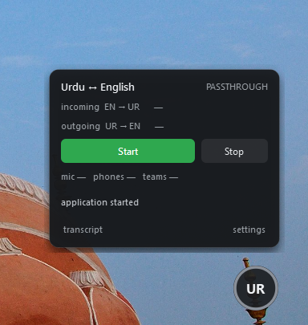
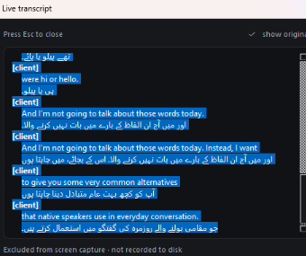
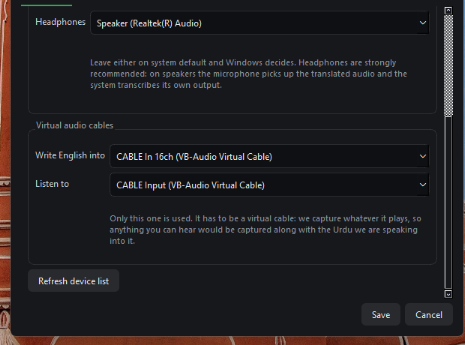
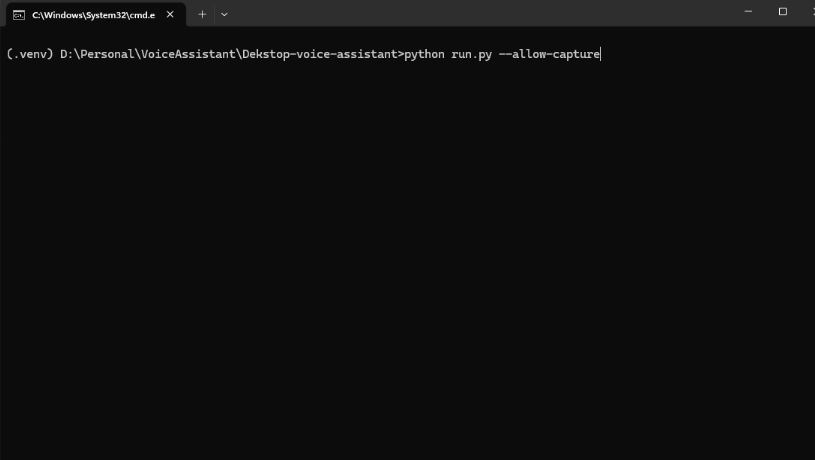

# Desktop Real-Time Voice Assistant & Translator

> **A real-time, low-latency desktop voice translation system that breaks language barriers between English-speaking international clients and Urdu speakers.**

---

## Overview

Millions of freelancers, remote workers and consultants in Pakistan and other
non-English-speaking countries work daily with clients in the US, UK and
Europe. Reading English is one thing; **following fast spoken English on a live
call, and answering fluently, is another.**

This Windows application sits quietly in the background and translates audio as
it happens:

- **Listen** — whatever is playing on your computer (a YouTube video, a Teams
  call, a podcast) is captured through virtual loopback routing, translated
  from spoken English into spoken Urdu in your headphones, and shown as live
  dual-language subtitles.
- **Two-way** — the client's English becomes Urdu for you, and your Urdu
  becomes English for them. Teams is never modified and never knows the app
  exists; it simply plays into and records from audio endpoints the app owns.
- **In sync** — for a recorded video, the whole transcript is translated
  *before* playback and each line is spoken at its own timestamp, so the Urdu
  lands exactly where the English was.

Three entry points, one for each of those:

| Command | What it does |
|---|---|
| `python run.py` | The desktop app: floating bubble, subtitles, settings. Asks once whether you are translating **something playing** or **a Teams call**. |
| `python listen.py` | One-way only, in a small window or a terminal. Needs one cable and no microphone. |
| `python pretranslate.py VIDEO` | A recorded video, translated ahead of time and played **in sync**. |

---

## Application Showcase

### 1. Main Floating Controller UI
The lightweight desktop controller sits quietly on your screen. Start and stop
translation, toggle subtitles, or open settings.



### 2. Live Subtitles & Transcript Window
Real-time side-by-side English transcription and Urdu translation, with clause
segmentation and no repeated lines.



### 3. Hardware & Audio Routing Settings
Pick your headphones, microphone and VB-Audio cable routing, and choose what
you are translating.



### 4. Terminal Launcher
Single-command startup for developers and power users.



---

## Setup

### 1. Prerequisites

- Windows 10 or 11, 64-bit
- Python 3.11+
- **[VB-Audio Virtual Cable](https://vb-audio.com/Cable/)** — required. See
  step 3.
- Headphones are strongly recommended. On speakers the microphone picks up the
  translated audio and the app transcribes its own output.

### 2. Install

```powershell
git clone https://github.com/shahhhashmatali2002/Dekstop-voice-assistant.git
cd Dekstop-voice-assistant
python -m venv .venv
.venv\Scripts\activate
pip install -r requirements.txt
pip install PySide6 websockets aiohttp openai keyring edge-tts miniaudio
```

Optional, for `pretranslate.py`:

```powershell
pip install youtube-transcript-api    # read a video's captions
pip install yt-dlp                    # or transcribe its audio instead
```

### 3. Install the virtual cable

Download VB-CABLE, extract the zip to a real folder, then right-click
`VBCABLE_Setup_x64.exe` → **Run as administrator** → accept the driver prompt →
**reboot**.

Installing without elevation appears to succeed and registers nothing, which
looks exactly like the driver being absent. Check afterwards:

```powershell
python listen.py --devices
```

The **Virtual cable check** section at the end says whether a cable is present,
and whether Windows is exposing it.

> **One cable or two?**
> One-way translation (a video, a podcast) needs **one** cable.
> Two-way Teams translation needs **two** — one carries your English into
> Teams, the other carries Teams' audio out where the app can capture it. They
> cannot be the same endpoint. For the second, install VB-CABLE A+B, or
> VoiceMeeter, which provides several.

### 4. API keys

Create a `.env` file in the project root:

```ini
DEEPGRAM_API_KEY=your_deepgram_api_key
OPENAI_API_KEY=your_openai_api_key
```

Or enter them in **Settings › API keys**, which stores them in Windows
Credential Manager instead of a file.

| Stage | Provider | Key |
|---|---|---|
| English speech → text | Deepgram `nova-3` | `DEEPGRAM_API_KEY` |
| English text → Urdu text | OpenAI `gpt-4o-mini` | `OPENAI_API_KEY` |
| Urdu text → voice | Microsoft Edge Neural TTS | none — free |
| Urdu voice (optional, better) | Azure Speech / ElevenLabs | `AZURE_SPEECH_KEY` + `AZURE_SPEECH_REGION`, or `ELEVENLABS_API_KEY` |

Edge TTS is the fallback and needs no key. If an Azure or ElevenLabs key is
present it is used instead.

Check what is configured:

```powershell
python listen.py --check
```

### 5. Route the audio

This is the step that makes you hear **only** Urdu, and it is manual because
Windows has no API to move another application's audio.

*Settings › System › Sound › Volume mixer › (Chrome, or Teams) › Output device
→ **CABLE Input***

Only that application moves. Your headphones stay the Windows default, so
everything else sounds normal.

**Why a cable is unavoidable:** what the app captures *is* the render stream of
the endpoint it captures from, so muting that endpoint mutes its own input too.
There is no gain setting that takes the English out of your ears and leaves it
in the app's. The English has to be rendered somewhere you are not listening.

---
## How to run

### Watching a video, or listening to a call — one way

```powershell
python listen.py
```

A small window with **Start**, **Pause** and **Subtitles**. Before Start you
hear the original English straight through the cable; Start mutes that and the
Urdu takes over the same headphones. Stop, Pause and any provider failure hand
the English back — you are never left in silence.

First run only:

```powershell
python listen.py --source "CABLE Input" --save
```

### The desktop app — either mode

```powershell
python run.py
```

Asks once what you are translating and remembers the answer:

| | **video** | **meeting** |
|---|---|---|
| capture | the cable your app is routed to | the cable Teams outputs to |
| play into | your speakers | your speakers |
| microphone | **not opened at all** | opened, translated to English |
| cables needed | one | two |
| directions | EN → UR | EN → UR and UR → EN |

Change it any time in **Settings › Devices › Source**, or with `--mode`.

### A recorded video, perfectly in sync

```powershell
python pretranslate.py "https://www.youtube.com/watch?v=..."
```

Live translation is always a few seconds behind the picture — a sentence has to
be spoken before it can be translated, and Urdu puts the verb where English
does not. A recording has no such problem: its words already exist.

1. it reads the transcript and joins the caption fragments into sentences
2. it translates and synthesises the first lines — seconds, not the whole video
3. you press play; it notices and starts
4. each line is spoken at the timestamp it belongs to
5. you pause; it notices and holds

Preparation continues while you watch, always a few lines ahead. It follows
your play and pause by watching whether the video's audio is still arriving on
the cable, so there is nothing to press in the app and nothing to keep in step.

If YouTube will not hand over captions — it serves bot checks to non-browser
clients, and some videos have captions disabled — skip them entirely:

```powershell
python pretranslate.py URL --transcribe
```

That downloads the audio with `yt-dlp` and transcribes it with Deepgram, which
returns sentence-level timestamps: **better timing than a caption track**,
because captions are cut to fit a screen rather than at meaning. It also works
on a local file, which the caption path cannot do.

---

## Every command

### `run.py` — the desktop app

```powershell
python run.py                      # the bubble; asks the mode on first run
python run.py --mode video         # something is playing: one cable, mic off
python run.py --mode meeting       # a two-way Teams call: two cables, mic live
python run.py --devices            # list audio endpoints and exit
python run.py --check              # verify the install and configuration
python run.py --ui-preview         # the overlay alone: no audio, no providers
python run.py --allow-capture      # let the windows appear in screenshots
```

| Flag | Meaning |
|---|---|
| `--mode {video,meeting}` | Which topology to open. Asked once and remembered if omitted. |
| `--devices` | Every playback and capture endpoint, plus the loopback endpoints. |
| `--check` | What is installed, which devices are set, which API keys are missing. |
| `--ui-preview` | The overlay with scripted data — no devices, no providers, no keys. |
| `--allow-capture` | Waive the screen-capture exclusion for this run. Never saved. |

### `listen.py` — one-way, live

```powershell
python listen.py                              # the window
python listen.py --console                    # no window; starts immediately
python listen.py --devices                    # playback endpoints + cable check
python listen.py --check                      # install, devices, keys — verified
python listen.py --source "CABLE Input" --save # remember the cable
python listen.py --out "Headset"              # where the Urdu is played
python listen.py --voice ur-PK-AsadNeural     # a male Urdu voice
python listen.py --preset fluent              # whole thoughts, more lag
python listen.py --preset fast                # short phrases, less lag
python listen.py --autostart                  # translate as soon as it opens
python listen.py --allow-capture              # let the windows be screenshotted
```

| Flag | Meaning |
|---|---|
| `--console` | No interface. Starts translating at once, prints subtitles, and prints a health line every 15 s. `Ctrl+C` quits. |
| `--devices` | Playback endpoints you can route to, the loopback endpoints, and whether a virtual cable exists. |
| `--check` | Resolves the configured source against real hardware and names the loopback it will capture through. Run this when it will not start. |
| `--source NAME` | The playback device your application is routed to — the cable. A case-insensitive fragment is enough. |
| `--out NAME` | Where the Urdu is played. Defaults to the Windows default device. |
| `--voice NAME` | Urdu TTS voice: `ur-PK-UzmaNeural` (default, female), `ur-PK-AsadNeural` (male), `ur-IN-GulNeural`, `ur-IN-SalmanNeural`. |
| `--preset {fluent,balanced,fast}` | The fluency/lag trade. Default `balanced`. |
| `--autostart` | Begin translating when the window opens, instead of waiting for Start. |
| `--allow-capture` | Waive the screen-capture exclusion for this run. Never saved. |
| `--save` | Remember the options above, print them, and exit without opening anything. |

**Presets.** A unit is emitted when the recogniser's text has been stable for
`stability_ms`, or when it reaches `max_words`. Short units reach your ears
sooner but are synthesised in isolation, so the voice restarts its prosody
every few words. Longer units are spoken as whole thoughts and arrive later.
There is no setting that is both.

| Preset | For | Behaviour |
|---|---|---|
| `fluent` | video | Whole thoughts, natural voice, several seconds behind. |
| `balanced` | default | A compromise. Start here. |
| `fast` | conversation | Short phrases, closest to real time. |

### `pretranslate.py` — a recorded video, in sync

```powershell
python pretranslate.py "https://www.youtube.com/watch?v=..."
python pretranslate.py 1bqQHEbVIFc                  # a bare video id works
python pretranslate.py "D:\clips\talk.mp4"          # a local file
python pretranslate.py URL --transcribe             # ignore captions
python pretranslate.py URL --start 1:30             # resuming mid-video
python pretranslate.py URL --offset -0.4            # consistently late? nudge
python pretranslate.py URL --out "Headset"          # where the Urdu is played
python pretranslate.py URL --lang en                # caption language to read
python pretranslate.py URL --no-follow              # start on Enter instead
```

| Flag | Meaning |
|---|---|
| `--transcribe` | Skip YouTube's captions: download the audio with `yt-dlp` and transcribe it with Deepgram. Slower and costs credit, but works on captions-disabled videos and on ones YouTube will not serve to a plain HTTP client. |
| `--start TIME` | Where the video is when you press play. Accepts `90`, `1:30` or `01:02:03`. |
| `--offset SECONDS` | Shift every line. Negative speaks earlier, positive later. |
| `--out NAME` | Where the Urdu is played. |
| `--lang CODE` | Which caption track to read. Default `en`. |
| `--no-follow` | Do not watch the cable. Start the clock when you press Enter, and ignore pauses. |

Lines more than two seconds past their moment are skipped rather than spoken
against the wrong picture. It reports how many at the end.

Urdu is often wordier than English, so some lines run longer than the gap the
English left. It says how many and by how much, and lets them overlap slightly
rather than cutting them off.

### Developer tools

```powershell
python tools\phase0.py devices                  # 1. find endpoint names
python tools\phase0.py mic --mic "Headset"       # 2. microphone level meter
python tools\phase0.py passthrough --mic "Headset" --out "Headset Earphone"
python tools\phase0.py loopback --target "CABLE Input"
python tools\phase0.py tone --virtual-mic "CABLE Input" --seconds 30
python tools\phase0.py wire --mic "Headset" --out "Headset Earphone" `
                            --virtual-mic "CABLE Input" --teams-speaker "CABLE-B Input"
python tools\phase0.py soak  ...same args...  --minutes 30
```

Each step proves exactly one thing about the audio path, in order. Every step
ends with health counters: **`overflows` and `underruns` must both be zero.**
Wear headphones for all of them — speakers create a feedback loop.

```powershell
python tools\replay.py sample.wav -v            # the whole pipeline, offline
python tools\replay.py sample.wav --sweep stability
python tools\bench_asr.py --list                # show the evaluation set
python tools\bench_asr.py --provider deepgram --lang ur --keyterms
```

`replay.py` runs VAD → stability → segmentation → latency with no devices and
no GUI. `--sweep` is the tuning exercise: endpointing dominates latency and has
to be tuned against recordings, not in a live meeting.

`bench_asr.py` reports **overall WER** and **technical-token WER** — the second
is the number that predicts whether the product works, and it is hidden inside
the first.

```powershell
python tools\say.py "ہم نے API کا test کیا"          # writes say.wav
python tools\say.py --english "The deployment failed."   # translate, then speak
python tools\say.py --show "YouTube پر 50% servers"   # no audio, just the text
python tools\say.py --speed 1.1 --voice ur-PK-AsadNeural "کیا حال ہے"
python tools\say.py --fragment "اور پھر ہم نے دیکھا"   # mid-sentence clause
```

`say.py` exists because the voice is the one thing that has to be judged by
ear, and starting the whole pipeline to hear one sentence means routing a
browser and hoping the line you wanted is the line that comes out.

`--show` prints what the voice will actually be given, after the Urdu
pronunciation pass — the fastest way to find a word missing from the
dictionary in `app/providers/urdu_speech.py`. `--speed` is what the drift
controller asks for when playback is behind: the voice is asked to read
faster rather than having its output time-stretched afterwards.

### Hotkeys

Work while Teams has focus, which is the whole point.

| Hotkey | Action |
|---|---|
| `Ctrl+Alt+Space` | Pause / Resume — the time-critical one |
| `Ctrl+Alt+T` | Start / Stop |
| `Ctrl+Alt+H` | Hide the bubble |

`Ctrl+Alt+Space` is claimed by Teams' own push-to-talk and by most input-method
editors, so a conflict is the common case. When one is taken the app binds an
alternative and tells you which — a silently moved hotkey is as useless as a
missing one. Set them explicitly in **Settings › Hotkeys** to stop them moving.

---
## Troubleshooting

**`no WASAPI endpoint matching 'CABLE Input'`**
Windows has no playback device with that name. WASAPI is not an alternative to
VB-Cable — it is how Windows exposes every endpoint, virtual cables included.
Run `python listen.py --devices` and read the **Virtual cable check** at the
end: it distinguishes "the driver is not installed" from "the driver is there
but Windows is not exposing it" (fix: `mmsys.cpl` → Playback → right-click →
Show Disabled Devices → enable).

**`Two-way mode needs TWO virtual cables and this machine has 1`**
Exactly what it says. Install a second cable, or use `--mode video` /
`listen.py`, which need only one.

**Three "feedback loop" errors at once**
Every role fell back to the same speaker. The app now repairs a cable role that
points at something audible, so this should not recur.

**`Deepgram did not receive audio data ... within the timeout window` (1011)**
The source went idle. A paused or crashed video renders nothing, and WASAPI
stops delivering callbacks for an endpoint nothing is playing into — that is
not silence, it is no stream. The app sends keepalive silence and reconnects up
to three times before giving up.

**Chrome: "Audio renderer error. Please restart your computer."**
Chrome's own state, not the app. Flip its output to Speaker and back to CABLE
Input in the volume mixer. It usually happens after `run.py` and `listen.py`
were both running — **run one or the other**, since they bind the same
endpoints.

**Screenshots come back without the app's windows**
Deliberate. Every window is excluded from screen capture (`WDA_EXCLUDEFROMCAPTURE`)
so that sharing your screen in a Teams call does not show the client a live
transcript of their own words. Use `--allow-capture` for one run.

**`invalid_request_error.beta_api_shape_disabled`**
The retired OpenAI Realtime beta wire shape. Fixed — the app no longer sends
`OpenAI-Beta: realtime=v1` and declares `session.type`. Only affects two-way
mode.

**`pip install yt-dlp` after you already installed it**
Was a bug: the app checked for the *command*, which pip puts in a per-user
Scripts folder that is usually not on PATH. It now imports the module.

**Only one line is translated, and then nothing**
Was a bug in the stability filter, now fixed. It restarted its confirmation
clock on every hypothesis, treating an *extension* of the recogniser's text as
a *revision* of it — so while anyone kept talking, nothing was ever confirmed,
and the only line that came out was the one the VAD flushed at the first pause.
Sixty-one words of continuous speech produced zero units.

**The terminal freezes and Ctrl+C does nothing**
Fixed. Qt's event loop blocks inside C++, so a timer now gives Python a chance
to run its signal handler. If it ever happens again: `Ctrl+Break`, or close the
app window.

---

## Core Technical Architecture

```
[ System Audio / Video ]
           │ (WASAPI loopback capture)
           ▼
[ Voice Activity Detection ]
           │ (speech frames)
           ▼
[ Deepgram Nova-3 streaming ASR ]  ──►  live English text
           │
           ▼
[ Stability filter + segmenter ]   ──►  whole clauses, never repeated
           │
           ▼
[ OpenAI gpt-4o-mini translator ]  ──►  contextual Urdu
           │
           ▼
[ Edge / Azure neural TTS ]        ──►  Urdu PCM
           │
           ▼
[ Jitter buffer → WASAPI render ]  ──►  headphones
```

### Key modules

- **`app/audio/`** — WASAPI capture and render over `PyAudioWPatch`, with
  single-producer/single-consumer ring buffers. The callbacks do one pre-sized
  numpy slice assignment and return: no allocation, no logging, no locks. A
  slow callback is a click in the user's ear.
- **`app/audio/passthrough.py`** — the always-on wire. Passthrough is the
  resting state, not "off": every failure path falls back to raw audio, never
  to silence.
- **`app/controllers/segmenter.py`** — stability filter and clause
  segmentation. `_emitted` is per-utterance state that survives a VAD pause,
  because the gate reports end-of-speech at every breath while the recogniser
  keeps extending one hypothesis across it.
- **`app/controllers/incoming.py`** — EN → UR. Owns a jitter buffer, a playback
  queue and the recogniser connection; nothing on the recognition path ever
  waits on the speech path.
- **`app/controllers/pretranslate.py`** — the synced mode: transcript, streamed
  preparation, a pausable clock, and a monitor that follows the video by
  watching audio *arrival* rather than loudness.
- **`app/providers/`** — every provider behind an abstract base class. Nothing
  in the pipeline knows a vendor name; swapping one is a config change.

### The three rules this codebase is built around

1. **The callback does nothing.** A PortAudio callback holds the GIL while it
   runs. If it is slow, the user hears a click.
2. **Passthrough is the resting state, not "off".** An engine that only moves
   audio while translating produces dead air whenever it is not.
3. **Every window is excluded from screen capture.** One window that misses it
   defeats the whole measure.

### Tests

```powershell
pytest
```

**335 tests pass.** Audio devices and network providers are faked, so the suite
runs anywhere — but that also means real devices and real provider calls are
not exercised by it. Notably tested: the ring buffer under threads, VAD and
segmentation, the repeat-and-swallow bugs replayed from real transcripts, the
jitter buffer, drift control, reconnection, the sync clock and pause handling,
and the provider wire shapes.

### Layout

```
Dekstop-voice-assistant/
├── run.py                  <- the desktop app, either mode
├── listen.py               <- one way, live, any application
├── pretranslate.py         <- a recorded video, in sync
├── app/
│   ├── models/             state, config, terminology, telemetry
│   ├── views/              overlay, transcript, settings, hotkeys, capture guard
│   ├── controllers/        main, engine, pipelines, VAD, segmenter, pretranslate
│   ├── audio/              WASAPI devices, streams, ring buffer, conversion
│   └── providers/          recognition, translation, voices, speech-to-speech
├── tools/                  phase0, replay, bench_asr, ui_preview
└── tests/
```

`audio/` and `providers/` sit beside the MVC triad rather than inside it: they
are I/O adapters. Controllers talk to them; views never do.

---

## Known limits

- **Live translation cannot be in sync**, and that is a property of time rather
  than a shortfall in the engineering: a sentence must be spoken before it can
  be translated. The floor is about 1.5–3 s. Use `pretranslate.py` for anything
  recorded.
- **Windows only.** WASAPI loopback and the capture exclusion have no
  cross-platform equivalent here.
- **The routing step is manual.** Windows has no supported API to move another
  application's audio to a different device.
- **`pretranslate.py` cannot work on anything live** — a call has no future to
  read ahead into.
- **Urdu is not an output language for any realtime speech-to-speech model**,
  which is why EN → UR must be a cascade while UR → EN can be a single model.

---

## Product Roadmap & Future Features

This release is a working prototype. Planned next:

- [ ] **Real-Time Voice Cloning** — zero-shot cloning (OpenVoice / XTTS /
      ElevenLabs) so outgoing English sounds like the user's own voice.
- [ ] **Direct Speech-to-Speech Engine** — audio-to-audio models for the
      lowest latency the cascade cannot reach.
- [ ] **Multi-Language Expansion** — Arabic, Spanish, French, German, Hindi,
      Mandarin.
- [ ] **AI Background Noise & Echo Cancellation** — WebRTC / RNNoise for live
      call environments.
- [ ] **1-Click Meeting Platform Integrations** — automated audio device
      pairing for Zoom, Google Meet, Teams and WhatsApp Desktop.
- [ ] **Offline Fallback Engine** — local Whisper + GGML so translation works
      without internet.
- [ ] **Process loopback (§5.2 / D7)** — capture a chosen application's audio
      directly, which would remove the virtual cable requirement entirely.
